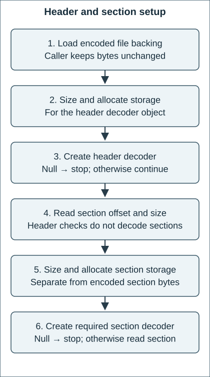
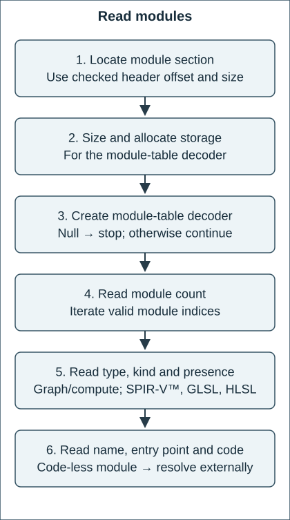
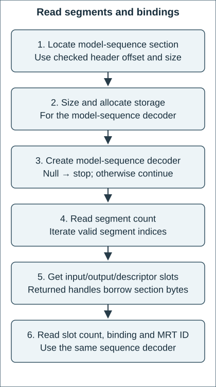
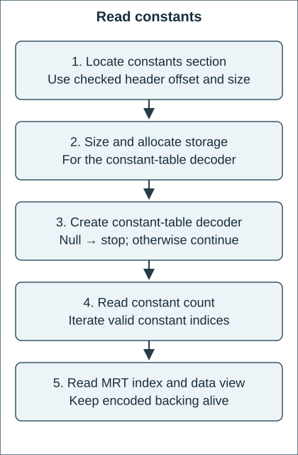

VGF Decoder C API
=================

The Decoder C API is an optional C API that reads the contents of VGF files. To decode the VGF file, the decoder C API takes the VGF file as input and drives the VGF Decoder API directly.
This API is a low-overhead thin C wrapper on C++ VGF Decoder API. The C linkage allows for higher ABI stability, and enables more options for additional language bindings and easier deployment or distribution of API updates.
The C API requires caller-provided decoder object storage, sized using the
corresponding memory-requirement call. C++ in-place factories also use supplied
storage, while ordinary C++ factories allocate and own their decoder objects.
The caller supplies the encoded section backing and performs file I/O. Keep this
backing unchanged and alive while decoders or borrowed raw-data and string views
use it; keep decoder storage alive while the decoder is in use. Retaining or copying a raw pointer or view
still requires its encoded backing, but does not itself require the decoder
object to remain alive. An owning copy of the bytes has an independent lifetime.

Caller-provided decoder storage does not guarantee that all calls avoid
allocations or system calls. Validation and logging can construct diagnostic
strings.

Similar to the VGF C++ Decoder API, the C API uses the following execution flow in order to parse a VGF file.
The VGF file has the following sections in the order specified (see enum ``mlsdk_section_name``)

  * :ref:`Modules Section`
  * :ref:`Model Sequence Section`
  * :ref:`Model Resource Section`
  * :ref:`Model Constants Section`

Each section of the VGF has its own decoder type. The memory requirement for each section decoder is retrieved by the corresponding calls, for example, function ``mlsdk_decoder_module_table_decoder_mem_reqs`` for Module section.
Each section of the VGF has its corresponding call for creating its decoder, for example, ``mlsdk_decoder_create_module_table_decoder`` function for Module section. These calls return ``nullptr`` on invalid input. Then, the created decoder reads data pertaining to that VGF section.



   Header and section setup.

The numbered setup actions map to these calls. Allocate decoder object storage
using the reported requirement, separately from the encoded file backing. Check
each factory result for null before calling any getter. Header creation checks
the header and declared section ranges; each section factory performs its own
validation. Consumers must still check references and execution requirements.

.. code-block:: c

   /* 2: header bytes and decoder object bytes are different sizes */
   mlsdk_decoder_header_size
   mlsdk_decoder_header_decoder_mem_reqs
   /* 3 */
   mlsdk_decoder_create_header_decoder
   /* 4 */
   mlsdk_decoder_get_header_section_info
   /* 5–6: use the section-specific pair listed below */


|

Modules Section
```````````````
``mlsdk_decoder_get_module_table_num_entries`` can use a module table decoder to retrieve the number of modules in a VGF file.
Modules can contain SPIR-V™ binary, GLSL source or HLSL source, or be placeholders
without embedded code. Module type (graph or compute), code kind and code
presence are separate properties; check the kind and presence before fetching
code. A runtime consumer must resolve placeholders before execution.
You can use the following functions to retrieve module information through a module table decoder:

    * **Name**: ``mlsdk_decoder_get_module_name``
    * **Type**: ``mlsdk_decoder_get_module_type``
    * **Entry point**: ``mlsdk_decoder_get_module_entry_point``
    * **SPIR-V™ kind and presence**: ``mlsdk_decoder_module_is_spirv``, ``mlsdk_decoder_module_has_spirv_code``
    * **SPIR-V™ code**: ``mlsdk_decoder_get_spirv_module_code``
    * **GLSL kind, presence and source**: ``mlsdk_decoder_module_is_glsl``, ``mlsdk_decoder_module_has_glsl_code``, ``mlsdk_decoder_get_module_glsl_code``
    * **HLSL kind, presence and source**: ``mlsdk_decoder_module_is_hlsl``, ``mlsdk_decoder_module_has_hlsl_code``, ``mlsdk_decoder_get_module_hlsl_code``

There can be more than one module entry in the module section of a VGF. To retrieve the number of modules, you can call ``mlsdk_decoder_get_module_table_num_entries``.



   Module-table decoding.

Calls for actions 1–4:

.. code-block:: c

   mlsdk_decoder_get_header_section_info
   mlsdk_decoder_module_table_decoder_mem_reqs
   mlsdk_decoder_create_module_table_decoder
   mlsdk_decoder_get_module_table_num_entries

Actions 5–6 use the kind, presence and data getters listed above. Returned raw
code and string pointers borrow the encoded backing; the decoder does not compile
or execute the modules.


|

Model Sequence Section
``````````````````````
Each segment refers to a module of the same type. A module can be shared by
multiple segments. All segments are stored in the model sequence table. To see the number of segments, you can use ``mlsdk_decoder_get_model_sequence_table_size``.
To retrieve the information for each segment, you can use their corresponding calls:

    * **Name**: ``mlsdk_decoder_model_sequence_get_segment_name``
    * **Type**: ``mlsdk_decoder_model_sequence_get_segment_type``
    * **Input binding slot**: ``mlsdk_decoder_model_sequence_get_segment_input_binding_slot``
    * **Output binding slot**: ``mlsdk_decoder_model_sequence_get_segment_output_binding_slot``
    * **Descriptor binding slot**: ``mlsdk_decoder_model_sequence_get_segment_descriptor_binding_slot``
    * **DescriptorSet info size**: ``mlsdk_decoder_model_sequence_get_segment_descriptorset_info_size``
    * **Graph constant bindings**: ``mlsdk_decoder_model_sequence_get_segment_constant_bindings``
    * **Constant-table indexes (index-only view)**: ``mlsdk_decoder_model_sequence_get_segment_constant_indexes``
    * **Dispatch shape**: ``mlsdk_decoder_model_sequence_get_segment_dispatch_shape``


Use the graph constant binding handle with
``mlsdk_decoder_graph_constant_binding_size`` to count bindings, then
``mlsdk_decoder_graph_constant_binding_get`` to read each
``mlsdk_decoder_graph_constant_binding`` through the same model-sequence decoder.
Each binding pairs a ``graph_constant_id`` identifying the constant in the
segment's graph with a ``constant_table_index`` locating its entry in the model
constants section. These values can differ: graph constant ID 10000 can refer to
constant-table entry 0.

The index-only getter returns constant-table indexes, not graph constant IDs;
do not substitute these indexes for IDs when consuming explicit bindings.
The binding API also supports legacy segments without explicit bindings,
returning an identity mapping in which each graph constant ID equals its
constant-table index.


The binding slot acts as a bridge between information on the resources used by a segment, and the resources. The resources are stored in the Model Resource Table (MRT). You can identify each resource using its MRT index.
The following components of a segment have information (including MRT index) of their corresponding resource in the MRT. You can obtain borrowed binding-slot handles with the corresponding calls:

    * **Segment inputs**: ``mlsdk_decoder_model_sequence_get_segment_input_binding_slot``
    * **Segment outputs**: ``mlsdk_decoder_model_sequence_get_segment_output_binding_slot``
    * **Segment descriptors**: ``mlsdk_decoder_model_sequence_get_segment_descriptor_binding_slot``

 You can use the binding slot to read:

    * Number of bindings of a binding slot of a segment component (inputs, outputs, descriptors): ``mlsdk_decoder_binding_slot_size``
    * Binding ids of entries in the binding slot: ``mlsdk_decoder_binding_slot_binding_id``
    * MRT indexes of entries in the binding slot: ``mlsdk_decoder_binding_slot_mrt_index``



   Model-sequence and binding-slot decoding.

Calls for actions 1–4:

.. code-block:: c

   mlsdk_decoder_get_header_section_info
   mlsdk_decoder_model_sequence_decoder_mem_reqs
   mlsdk_decoder_create_model_sequence_decoder
   mlsdk_decoder_get_model_sequence_table_size

Action 5 uses the input, output or descriptor slot getter listed above. The result
is an opaque handle into the encoded section, not another decoder object to
allocate. Pass it back with the same model-sequence decoder for action 6:

.. code-block:: c

   mlsdk_decoder_binding_slot_size
   mlsdk_decoder_binding_slot_binding_id
   mlsdk_decoder_binding_slot_mrt_index


|

Model Resource Section
``````````````````````
This section describes the Model Resource Table (MRT). The MRT contains all the Model Resource entries of the VGF file. To find resources through their unique MRT index, you can use the MRT as a lookup table from the other sections of the VGF.

Model Constants Section
```````````````````````
The model constants section is the largest section of a VGF file, which contains VGF constants information.

.. caution::
   The data in the constant section is stored in raw bytes, there are no endianness checks. The target host and the host where you create the VGF must use the same endianness.

To retrieve the number of constants in a VGF file, using a constants table decoder, you can use ``mlsdk_decoder_get_constant_table_num_entries``.
To retrieve constant information through a constants table decoder, you can use the following functions:

    * **MRT index**: ``mlsdk_decoder_constant_table_get_mrt_index``
    * **Data**: ``mlsdk_decoder_constant_table_get_data``



   Constant-table decoding.

Calls for actions 1–5, in order:

.. code-block:: c

   mlsdk_decoder_get_header_section_info
   mlsdk_decoder_constant_table_decoder_mem_reqs
   mlsdk_decoder_create_constant_table_decoder
   mlsdk_decoder_get_constant_table_num_entries
   mlsdk_decoder_constant_table_get_mrt_index
   mlsdk_decoder_constant_table_get_data

The memory-requirements call reports decoder object storage bytes; the creation
call takes the encoded section, its size and the separately allocated storage.
It returns null for invalid section input. Keep the encoded backing alive and
unchanged while borrowed constant data is used.


|
|

C Decoder API Reference
-----------------------

.. doxygengroup:: VGFCAPI
    :project: MLSDK
    :content-only:
